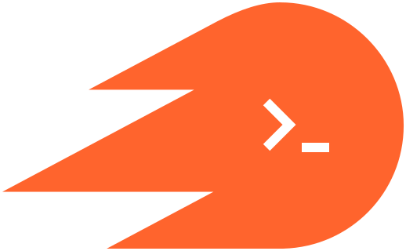

<p align="center">
  
</p>
<h1 align="center">semrush-cli</h1>
<p align="center">
  <a href="https://github.com/Microck/semrush-cli/actions/workflows/ci.yml"></a>
  <a href="https://www.npmjs.com/package/semrush-cli"></a>
  <a href="https://github.com/Microck/semrush-cli/releases/latest"></a>
  <a href="LICENSE"></a>
</p>

---

semrush from your terminal and MCP clients. keyword research, organic rankings,
competitors, backlinks and AI visibility, through your signed-in web account.
built with TypeScript + Effect. sessions stored in Galleton.

[docs](https://semrush.micr.dev) · [npm](https://www.npmjs.com/package/semrush-cli) · [mcp](#mcp) · [issues](https://github.com/Microck/semrush-cli/issues)

## why

89 operations with the same input schemas in the CLI and MCP. JSON output for
scripts, account totals and pagination, project management, and encrypted session storage.
no Semrush developer API key or Python runtime required.

The executable is `semrush-cli`. It can coexist with other tools named `semrush`.

## quickstart

Requires Node.js 22+. Includes Galleton binaries for Linux x64/arm64,
macOS x64/arm64 and Windows x64.

```sh
npm install -g semrush-cli
semrush-cli setup
semrush-cli auth login
semrush-cli domain-overview --domain openai.com --json
```

`setup` installs Chromium and starts a private Galleton daemon. `auth login`
opens an isolated browser for sign-in, verifies the session, and stores it in
Galleton. It requires a graphical desktop. On Linux, missing Chromium system
libraries can be installed with `npx patchright install-deps chromium`.

To import an existing, authorized Chromium session on a headless machine:

```sh
semrush-cli auth import --cdp-url http://127.0.0.1:9234
semrush-cli doctor --json
```

The browser must already expose CDP on a literal loopback HTTP address. This
supports the browser managed by [semrush-web-mcp](https://github.com/Microck/semrush-web-mcp).
Import does not stop or change that browser. Keep CDP private; forward it over
SSH when necessary.

## projects

```sh
semrush-cli projects --json
semrush-cli project-create --name 'my website' --domain example.com --dry-run
semrush-cli project-create --name 'my website' --domain example.com --confirm --json
semrush-cli project-get --folder-id 123 --json
semrush-cli project-update --folder-id 123 --name 'new name' --confirm
semrush-cli project-set-tags --folder-id 123 --tags '["client"]' --confirm
semrush-cli project-pin --folder-id 123 --pinned --confirm
semrush-cli project-delete --folder-id 123 --confirm
```

Project commands use the current web UI's folder IDs. Creation does not start
crawls or share the project. Every write requires `--confirm`; `--dry-run` prints
the request without authentication or network access. SEO project creation and
automatic Site Audit/Position Tracking setup are separate, explicit commands.
See [projects](https://semrush.micr.dev/docs/projects) and
[web UI coverage](https://semrush.micr.dev/docs/coverage).

## keyword lists

```sh
semrush-cli keyword-lists --json
semrush-cli keyword-list-create --name 'research' --confirm --json
semrush-cli keyword-list-import --basket-id 456 --owner-id 123 --keywords '["email marketing"]' --confirm
semrush-cli keyword-list-keywords --basket-id 456 --owner-id 123 --page-size 20 --json
semrush-cli keyword-list-add-tags --basket-id 456 --owner-id 123 --keywords '["email marketing"]' --tags '["opportunity"]' --confirm
semrush-cli keyword-strategy-create --name 'example strategy' --domain example.com --dry-run
```

Builder list IDs and owner IDs come from `keyword-lists`. Regular list creation
and structured strategy generation are separate commands. Metric refresh and
clustering require explicit confirmation and consume account allowances.
See [keyword lists](https://semrush.micr.dev/docs/keyword-lists).

## site audit

```sh
semrush-cli audit-create --campaign-id 456 --name "Example audit" --domain example.com --page-limit 100 --confirm
semrush-cli audit-start --campaign-id 456 --confirm
semrush-cli audit-snapshots --campaign-id 456
```

[Site Audit guide](https://semrush.micr.dev/docs/site-audit). Configuration and launch are separate. Defaults use manual scheduling and no email.


## commands

```sh
semrush-cli keyword-overview --keyword 'email marketing' --json
semrush-cli keyword-magic --keyword 'email marketing' --questions-only --page-size 20 --json
semrush-cli domain-keywords --domain openai.com --page 2 --page-size 20 --json
semrush-cli domain-competitors --domain openai.com --page-size 10 --json
semrush-cli keyword-gap --domains '["openai.com","anthropic.com"]' --json
semrush-cli backlink-gap --domains '["openai.com","anthropic.com"]' --json
semrush-cli backlink-links --domain openai.com --filters '+|type||nofollow' --json
semrush-cli domain-ai-visibility --domain openai.com --json
semrush-cli snapshot-dates --database us --json
semrush-cli reports --json
semrush-cli domain-keywords --help
```

| Area | Reports |
| --- | --- |
| Keywords | Overview, ideas, questions, SERPs, ads, clusters, paginated Keyword Magic and groups |
| Organic | Rankings, pages, subdomains, changes, competitors, topics and trends |
| Gaps | Keyword overlaps and gaps, backlink prospects and profile comparisons |
| Backlinks | Links, referring domains, anchors, indexed pages, outbound domains, history and authority |
| AI visibility | Visibility, mentions, citation sources and country distribution |
| Keyword lists | Create, read, rename/delete, import, metrics, tags, deletion/undo, clustering and structured strategy generation |
| Projects | Create, inspect, rename, delete, leave, tags, pinning, toolkit status, dashboard metrics and explicit SEO setup |
| Site Audit | Create/configure, explicit launch, status, limits, history and snapshots |
| Account | Limits, permissions, databases, snapshots, folders, saved lists and audit campaigns |

All successful reports use `{authenticated: true, report, data}`. Domain ranking
and page reports include provider totals. Large integers remain exact as decimal
strings. Errors go to stderr with a nonzero exit. `--json` works before or after
the command. Objects and arrays use JSON flags; booleans support explicit `false`.
See the [full command reference](https://semrush.micr.dev/docs/reports).

## mcp

Complete setup and authentication, then configure your MCP client:

```json
{
  "mcpServers": {
    "semrush": {
      "command": "semrush-cli",
      "args": ["mcp"]
    }
  }
}
```

Use an absolute executable path if your client does not inherit the terminal's
PATH. `npx -y semrush-cli@0.4.0 mcp` also works. MCP tool names use underscores,
for example `keyword_overview` and `domain_keywords`. Input schemas and reports
match the CLI. The 67 read tools carry read-only annotations. The 22 write tools require
`confirm:true`, or accept `dry_run:true` to preview the request. Delete and leave
also carry destructive annotations. Login, arbitrary URLs and JavaScript
execution are not MCP tools.

## sessions

```sh
semrush-cli auth status --check --json
semrush-cli auth logout
semrush-cli daemon stop
semrush-cli daemon start
```

Galleton stores credentials under `~/.local/share/semrush-cli/galleton`. The
private daemon listens on `127.0.0.1:8771`. It continues after the terminal closes;
run `daemon start` after reboot. The CLI installs no system startup service.

Each CLI process restores its encrypted session into a fresh, transient Chromium
context. The MCP server reuses one context and serializes requests. Successful
reports capture cookie updates back to Galleton. Session expiry requires sign-in
or import again. No anonymous fallback or automatic request retries.

The unchanged Galleton TypeScript SDK is vendored at a pinned upstream commit
because it is not on npm. The bundled daemon adds a tested `static` provider for
storage without renewal. Semrush has no proven renewal contract in the reference
integration, so this tool does not invent one. See [architecture](docs/architecture.md)
and [SDK provenance](src/vendor/README.md).

| Variable | Default |
| --- | --- |
| `SEMRUSH_GALLETON_URL` | `http://127.0.0.1:8771` |
| `SEMRUSH_GALLETON_TOKEN_FILE` | `~/.local/share/semrush-cli/galleton/api.token` |
| `SEMRUSH_SESSION` | `semrush-cli` |
| `SEMRUSH_BROWSER_EXECUTABLE` | Patchright's Chromium |

The setup/daemon commands manage only the default CLI-owned daemon. An external
daemon must support the documented static-provider extension. Never expose its
API token or credential directory.

## limits

Semrush account permissions, quotas and product access apply. A read-only report
can consume an allowance. Internal web endpoints may change. Provider caps remain
visible; there is no unlimited-export claim. Galleton encrypts at rest but its key
and vault share a private local directory. Other processes running as your OS user
are within the same trust boundary.

## development

```sh
npm ci
npm run check
npm --prefix docs-site ci
npm --prefix docs-site run build
```

Development builds require Go 1.23+ and `tar`/`patch` to build the pinned Galleton
daemon with its storage-only extension. The build runs the upstream core suite
with the extension's integration test. Published users do not need Go.

Tests compare all 48 request shapes against the Python reference, use real
Chromium and Galleton with a local HTTP fixture, and exercise the built executable.
They never require a Semrush account. See [verification](docs/verification.md) for
the separate live-account evidence.

## uninstall

```sh
semrush-cli auth logout
semrush-cli daemon stop
npm uninstall -g semrush-cli
```

The private vault and browser cache remain on disk. Remove them only after
checking they contain nothing you need.

MIT. Independent project, not affiliated with Semrush.
